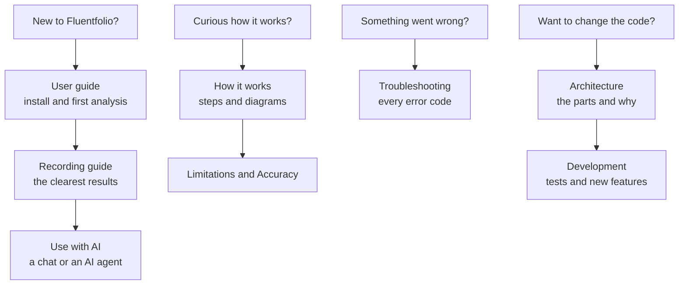

# Fluentfolio documentation

Start at the top and go down as far as you need. The pages for using Fluentfolio are written for learners, not programmers; the last group is for people who want to change the code. The app has the short version of the first three pages on its Help page.

The links are in the tables below.

## Use it

| Page | Read it when you want to... |
|---|---|
| [User guide](user-guide.md) | install Fluentfolio and run your first analysis, step by step |
| [Recording guide](recording.md) | record a practice test so that the results are as clear as possible |
| [Use with AI](use-with-ai.md) | get an estimate from an AI chat, check its answer, add audio, or let an AI agent on your computer run Fluentfolio |

## Understand it

| Page | Read it when you want to know... |
|---|---|
| [How it works](how-it-works.md) | what happens inside, with diagrams, and what it does in unusual cases |
| [Limitations](limitations.md) | what Fluentfolio cannot do or cannot promise |
| [Accuracy](accuracy.md) | how well each part did on test data, with the numbers |
| [Privacy](privacy.md) | what stays on your computer, what goes online, and what deleting removes |

## Look something up

| Page | Use it for... |
|---|---|
| [Troubleshooting](troubleshooting.md) | every error and warning code, with what to do |
| [Command line](cli.md) | the `fluentfolio` command, its options, exit codes and JSON output |
| [Install options](install.md) | the installer's options for repair, other folders and testing |

## Change it

| Page | Read it when you want to... |
|---|---|
| [Architecture](architecture.md) | understand the processes, packages, job files, folders and security model, and why they are built that way |
| [Development](development.md) | run it from source, run the tests, see how the web app and the command line are tested, and add a measure, step, part, setting, error code or action |

## The project

| Page | What it holds |
|---|---|
| [README](../README.md) | the front page |
| [CHANGELOG](../CHANGELOG.md) | what changed in each version |
| [SECURITY](../SECURITY.md) | how to report a security problem, and what is in scope |
| [CONTRIBUTING](../CONTRIBUTING.md) | how to report a problem or change the code |
| [Third-party notices](../THIRD_PARTY_NOTICES.md) | the licences of every part Fluentfolio uses |
