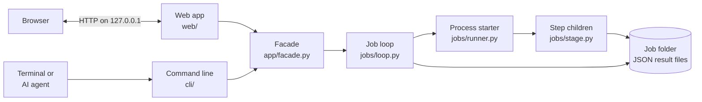
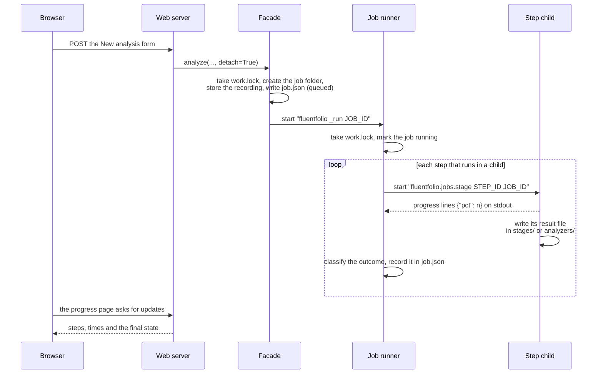
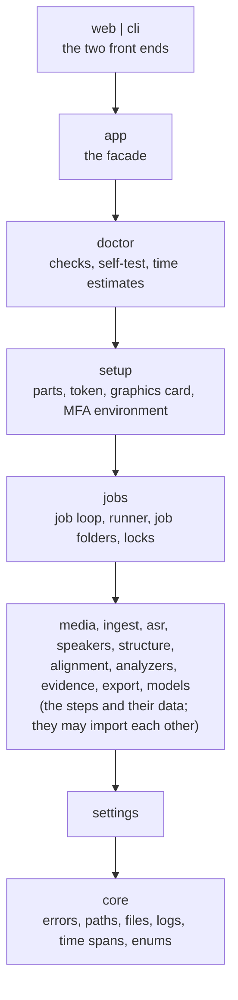
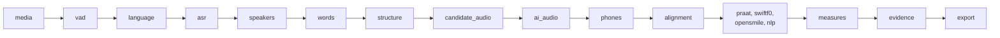
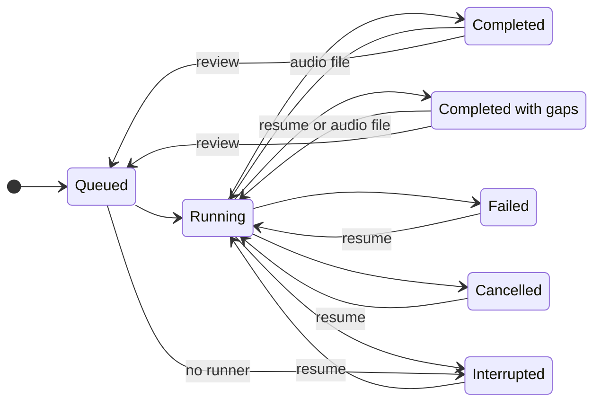

# Architecture

This page is for developers: people who want to understand how Fluentfolio works inside, rebuild part of it, or add a feature. If you only want to use Fluentfolio, the [user guide](user-guide.md) and [how it works](how-it-works.md) are enough. To set up the code and change it, read [development](development.md) next.

**Contents:** [The big picture](#the-big-picture) | [Processes](#processes) | [Packages and layers](#packages-and-layers) | [The job pipeline](#the-job-pipeline) | [The job folder](#the-job-folder) | [Job states](#job-states) | [Folders and locks](#folders-and-locks) | [Child processes](#child-processes) | [Models and parts](#models-and-parts) | [Evidence and export](#evidence-and-export) | [The web app](#the-web-app) | [The command line](#the-command-line) | [Errors](#errors) | [Settings](#settings) | [Why it is built this way](#why-it-is-built-this-way)

## The big picture

Fluentfolio is one Python 3.12 package, `fluentfolio`. The installer puts it in its own virtual environment in the app folder. It has two front ends, a web app and a command line, and both call one shared set of functions, the facade (`src/fluentfolio/app/facade.py`). An analysis is a **job**. A job runs a fixed list of **steps** (I also call them stages in the code). Each heavy step runs in its own child process and leaves one JSON result file in the job's folder. The next step reads those files.



## Processes

Up to five kinds of process take part in one analysis started from the web page:

| Process | Started as | Its job |
|---|---|---|
| Web server | `python -m fluentfolio.web` (by `fluentfolio serve` or the Start menu shortcut) | Serves the pages on 127.0.0.1. One per data folder, guarded by `app.lock`. |
| File check | `python -I -X utf8 -m fluentfolio.media.probe <file>` | Reads a recording's format, tracks and length before a job starts, so the decoder never loads in the server or the command. |
| Job runner | `python -I -X utf8 -m fluentfolio _run <job id>` | Runs one job's steps in order, holding `work.lock`. A hidden command of the command line. |
| Step child | `python -I -X utf8 -m fluentfolio.jobs.stage <step id> <job id>` | Runs one step and writes its result file. For speaker separation, the step id names the tool: `speakers-pyannote` or `speakers-sherpa`. |
| Outside program | its own absolute path | MFA (only if you chose it) and `nvidia-smi` (the graphics card check). |

From the command line, `fluentfolio analyze` runs the job loop in its own process by default, so there is no separate job runner. With `--detach` it starts a job runner that outlives the command. The web app starts the job runner as its own child (`web/tasks.py`), so closing the app stops the job cleanly: the job becomes "interrupted", and Run again goes on from its first step that did not finish.



## Packages and layers

The code in `src/fluentfolio/` is split into packages. A package may import only from the layers below it. `import-linter` checks this in the fast check, which you run before every commit and CI runs on every push (the contracts are in `pyproject.toml`).



| Package | What it holds |
|---|---|
| `core` | The error catalogue (`errors.toml`), folder rules (`paths.py`), safe file writes, the log redaction filter, time spans in milliseconds, and the spellings of modes, layouts and states. |
| `settings` | Every key of `settings.toml`, with its default and allowed values, and loading and saving it. |
| `media` | Decoding the recording into 16 kHz mono WAV, audio quality, the music check, and each candidate's own audio. |
| `ingest` | Taking a recording in (type, size and length limits), the question list and the learner's own transcript. |
| `asr` | Speech recognition: the voice activity detector (VAD), Parakeet, Whisper, and the language check. |
| `speakers` | Speaker separation with pyannote or sherpa-onnx, one track per person, and giving each word to a person. |
| `structure` | Questions, answers, roles and the three Parts, and the review form's corrections. |
| `alignment` | Word and phone times: the CTC aligner, MFA and its output check, and the pronunciation pointers. |
| `analyzers` | The acoustic tools (Praat, SwiftF0, openSMILE), the grammar parser (spaCy) and all the measures. |
| `evidence` | `evidence.json`: its models, its fixed labels, and the step that builds it. |
| `export` | The text for an AI chat, the ZIP, the audio check, the answer checker and the grading prompts. |
| `models` | The component catalogue (`data/models.toml`) and downloads checked against SHA-256 hashes. |
| `jobs` | The job loop, the only module that starts processes (`runner.py`), job folders, and the locks. |
| `setup` | Installing and removing parts, the Hugging Face token, the graphics card check, the MFA environment. |
| `doctor` | The system check, the self-test, the diagnostic report and the time estimates. |
| `app` | The facade: every action of the app, as plain functions. |
| `web`, `cli` | The two front ends. They hold no logic of their own beyond showing results. |

Some contracts keep libraries apart, because they crash or clash in one process: sherpa-onnx ships its own ONNX Runtime, torch and CTranslate2 bring two OpenMP and CUDA stacks, and openSMILE's non-commercial licence must never meet GPL code in one process. Another contract keeps the front ends, `app`, `doctor` and `setup` free of heavy libraries such as torch, so the app starts fast.

## The job pipeline

`facade.plan()` gives a job's steps in run order. A step runs in one of three ways: as a **child** process, **inline** (a plain function in the job runner, for quick steps), or as an **outside program** (MFA). The table lists them for an analysis.

| Step | Runs as | Needed | Result file | Code |
|---|---|---|---|---|
| media | child | yes | `stages/media.json` | `media/decode.py` |
| vad | child | yes | `stages/vad.json` | `asr/vad.py` |
| language | child | no | `stages/language.json` | `asr/language.py` |
| asr | child, GPU allowed | yes | `stages/asr.json` | `asr/base.py` |
| speakers | child in a mixed recording (pyannote, GPU allowed, or sherpa-onnx) and in solo (sherpa-onnx's second-voice check); inline with one track or file per person | no | `stages/speakers.json` | `speakers/pyannote.py`, `speakers/sherpa.py`, `speakers/tracks.py` |
| words | inline | yes | `stages/words.json` | `speakers/ownership.py` |
| structure | inline | yes | `stages/structure.json` | `structure/build.py` |
| candidate_audio | child | no | `stages/candidate_audio.json` | `media/slices.py` |
| ai_audio | child | no | `stages/ai_audio.json` | `media/slices.py` |
| phones | child | no | `stages/phones.json` | `alignment/phones.py` |
| alignment | outside program (MFA) | no | `stages/alignment.json` | `alignment/mfa.py` |
| praat, swiftf0, opensmile, nlp | child | no | `analyzers/<name>.json` | `analyzers/<name>.py` |
| measures | inline | yes | `analyzers/measures.json` | `analyzers/measures/collect.py` |
| evidence | inline | yes | `stages/evidence.json`, and `evidence.json` at the job's top level | `evidence/build.py` |
| export | inline | yes | `stages/export.json` | `export/bundle.py` |

The speaker step is never needed: if it fails, nobody gets a role, the results say so, and the learner can set the roles in the review form.

**How a child works.** `jobs/stage.py` maps the step ID to a module and function. The child reads its inputs from the job folder, prints progress as JSON lines such as `{"pct": 40}` on standard output, and writes one result file. Every result has a `status`: `ok`, `partial`, `skipped`, `unavailable`, `failed` or `disabled` (`core/enums.py`). A failed result also has an error `code`, and the child records its peak memory.

**How the loop judges a step.** `jobs/loop.py` reads only two things: the child's exit code and its result file (`classify()`). A child that exits without a result file failed: from its last error lines, the loop tells running out of memory (`E_RAM_OOM`) from a crash (`E_STAGE_CRASHED`). A step that fails on the graphics card (`E_GPU_OOM`, `E_CUDA_RUNTIME` or a crash) runs once more on the CPU; the job records this fallback and the results say so.

**Time limits.** Each step has a backstop of `base_s` plus `per_min_s` for each minute of audio, three times that on the CPU, and a watchdog that stops a child that reports no progress for too long (a setting).

**Resume.** Each step saves its result, so a job can go on after a stop. `store.resume_point()` finds the first result that is missing or not finished (`ok` or `disabled`), deletes every result after it, and the loop runs from there. A review-form correction deletes `stages/structure.json`, so the job runs again from the structure step, or from an earlier result that is not finished; the transcript is made again only when the language step's result is not finished. A re-run in another mode starts from the first step that the mode changes, and a later `resume` or review-form correction of that job keeps the steps before it as they are, gaps included.



## The job folder

Every job lives in `<data folder>/jobs/<job id>/`. A job ID looks like `20261013-101500-ab12`: the UTC date and time, and four random hex digits. No part of a file name you chose ever enters a folder name.

```
<job id>/
  job.json            the job record: mode, layout, settings copy, state, one record per step
  input/              source.<ext> (and source_2.<ext> for a second file), the optional question list
                      and the learner's own transcript, with the names found in its labels replaced;
                      removed_names.json lists those names for the answer check and is never exported
  stages/             one result file per pipeline step
  analyzers/          one result file per acoustic or grammar tool, and measures.json
  evidence.json       all the evidence, checked against docs/schemas/evidence-v1.schema.json
  export/
    for_ai/           for_ai.txt (or one per person in role swap), and the optional audio
    details/          evidence.json, transcript.md, acoustics_by_tool.json, a README, and
                      egemaps_88.csv when openSMILE ran
    fluentfolio_<job id>.zip
  logs/job.log        the job's own log: counts, times, codes, never words from the recording
  overrides.json      the review form's corrections, if any
```

`job.json` is written whole each time (to a temporary file, then renamed), and only by the process that holds `work.lock`.

## Job states



The states are in `core/enums.py` (`JobState`). A job is **completed with gaps** when no needed step failed, but some step's result is not finished (neither `ok` nor `disabled`), or a step used its fallback. Examples of a result that is not finished are an optional step that failed, and a structure step that found no roles or the same voices on both tracks (`partial`). A fallback is the CPU after a GPU failure, or sherpa-onnx when pyannote failed or is not installed (with the automatic speaker separation). A `disabled` step is not a gap. It is a part the learner switched off or one a light run turns off. The step that makes the audio file for an AI chat is `disabled` when it is not asked for (the default), and so is openSMILE without its licence consent. A job whose runner does not start within 15 seconds of a detached start is marked **interrupted** (`E_RUNNER_NOT_STARTED`). `resume` on a job with gaps runs it again from its first result that is not finished, if there is one. Making the optional audio file later runs the audio, evidence and export steps again. A job whose runner died is found by the next process that takes `work.lock` (`loop.housekeeping()`) and marked **interrupted**. A **cancel** writes a `cancel.request` file into the job folder; the job's own loop sees it, stops its child and records the state.

## Folders and locks

| Folder | Default on Windows | Default on Linux | Holds |
|---|---|---|---|
| App folder | `%LOCALAPPDATA%\Fluentfolio` | `~/.local/share/fluentfolio` | The program, its Python, the models, tools and temporary files. Safe to delete and reinstall. |
| Data folder | `%LOCALAPPDATA%\Fluentfolio-data` | `~/.local/share/fluentfolio-data` | Settings, jobs and logs. Never touched by a reinstall or an update. |
| Models folder | `<app folder>\models` | `<app folder>/models` | The downloaded models. |

`FLUENTFOLIO_APP_ROOT` and `FLUENTFOLIO_HOME` move the app and data folders for one process, which the tests use. Settings can move the data and models folders for good; the new place is kept in the installer's `state.json` (`core/paths.py`). On Windows, the app folder's path must be ASCII, without spaces, under 60 characters, outside OneDrive and on a local NTFS disk, because MFA, Kaldi and eSpeak fail on other paths there. The installer checks the app folder of a new install (`Get-PathProblems` in `install.ps1`), and `path_problems()` applies the same rule to a models folder moved in Settings.

Two locks, both operating-system byte locks that the system releases when the holding process dies (`jobs/locks.py`):

- **`app.lock`**: one web server per data folder. A second start opens the running app instead.
- **`work.lock`**: one writer at a time. Analyses, installs and removals of parts, the self-test, deleting jobs and moving folders all take it, so two of them never change the same files or share the graphics card. A second one is refused with `E_BUSY`.

## Child processes

`jobs/runner.py` is the only product module that starts processes: in the product code, ruff's rule S603 (a process started from Python) is allowed in that file alone. It:

- starts every child from an argument list, never through a shell, with an absolute program path, and refuses `.bat` and `.cmd` files;
- puts each child in a kill-on-close Job Object on Windows, or its own process group on Linux, so a stopped job leaves no orphan processes;
- builds each child's environment from an allow-list (`child_env()`): a few system variables, a constructed `PATH`, temporary folders inside `<app folder>/tmp/<job id>`, and switches that turn off telemetry and network access in the libraries. A Hugging Face token or `PYTHONPATH` in the parent never reaches a child;
- reads the child's progress and error lines, and stops a child that runs too long or stops reporting progress.

Children start Python with `-I` (isolated mode), so they ignore `PYTHONPATH` and the user's site packages.

## Models and parts

Every downloadable part is a **component** in `src/fluentfolio/data/models.toml`: its ID, files, download URLs, SHA-256 hashes, size, licence, whether it is offered, and whether it is ticked by default. `models/catalogue.py` reads it; `models/download.py` downloads each file, checks its hash before it is kept, and unpacks archives safely. Every URL starts with `https://` and points at an allowed host. Model files load only from these checked local copies, never from the internet at analysis time.

openSMILE is installed only after the learner accepts its licence (`setup/components.py` keeps that consent). pyannote needs the learner's own Hugging Face token, which `setup/token.py` saves through `huggingface_hub`'s own files, never in Fluentfolio's.

## Evidence and export

The **evidence** step turns the result files into one `evidence.json` per job. Its shape is defined by pydantic models in `evidence/models.py`, and `docs/schemas/evidence-v1.schema.json` is generated from them. Each measure has a fixed ID, unit, reliability label, source tool and plain definition (`evidence/labels.py`). A value that cannot be measured is empty, with the reason.

The **export** step writes the text for an AI chat (`export/for_ai.py`): one candidate's evidence as tagged plain text between two boundary lines, with the grading prompt from `export/prompts/`. Text that goes to an AI chat passes through `core/text.py`, which removes invisible characters that could hide instructions. The **answer checker** (`export/answer_check.py`) checks a chat's answer against the prompt's rules.

## The web app

The web app is FastAPI with Jinja templates and htmx, and plain CSS with no build step. `web/pages.py` holds the routes; each reads or acts through the facade and fills one template. Long actions (an analysis, installing parts, the self-test, writing the export again) run as command-line commands in child processes of the server (`web/tasks.py`).

Security (`web/security.py`, `web/server.py`):

- The server listens on 127.0.0.1 only, and accepts only `127.0.0.1` and `localhost` as the host name.
- Each server start makes a new random launch token and session secret. The token goes only into two files in the data folder that this user alone can read (`server.json` and `open.html`, never onto a command line, where other users of a Linux computer could see it), and both files are deleted when the server stops. The shortcut opens `open.html`, which leads to `/auth?t=<token>`; that page sets the session cookie.
- Every request needs the session cookie. Every change (POST and the like) must also come from the app's own origin, shown by the browser's `Sec-Fetch-Site: same-origin` header (or the `Origin` header in older browsers), and carry htmx's `HX-Request` header. Anything else gets a plain 403 page (`web/security.py`, `Guard`).
- Every response carries a strict content security policy (no inline script or style), `no-store` caching, `nosniff`, `no-referrer` and a same-origin resource policy. The app has no websocket and refuses any.

## The command line

The command line is a Click group (`cli/main.py`); each command calls the facade (`cli/commands.py`, `cli/setup_commands.py`). With `--json`, every command prints exactly one JSON object (`cli/envelope.py`), whose schema is in `docs/schemas/`. `cli/main.py` is the one place that turns an outcome into an exit code. See [command line](cli.md).

## Errors

Every error and warning has a code in `src/fluentfolio/core/errors.toml`, with its category (which sets the exit code), severity, title, message, hint, whether a retry can help, and its troubleshooting link. Code raises one of a few exception classes in `core/errors.py` with a code. The web app shows the code's card, and the command line prints it and exits with its code. The [troubleshooting](troubleshooting.md) page has one section per code, and a test checks that the two match.

## Settings

`settings/model.py` defines every key of `settings.toml` with its default, allowed values, label and help text; the Settings page and `fluentfolio settings` are built from it. The file lives in the data folder. Each job keeps a frozen copy of the settings it started with, in `job.json`, so a later change never alters an analysis that already ran.

## Why it is built this way

- **On your computer, and offline.** A practice recording holds a learner's voice and often a partner's. I wanted it to stay on the learner's computer. After the install, an analysis makes no network calls, and the tests run it with sockets blocked.
- **Evidence, not a band.** Fluentfolio measures and shows its working. The band comes from an AI chat the learner chooses, as an unofficial estimate, with a prompt that asks for reasons and quotes.
- **One process per heavy step.** Speech and audio libraries are large, use the graphics card, and sometimes crash or clash. In its own process, a step can crash or run out of memory without taking the app down, and the job records which step failed and why.
- **Files between steps.** Each step reads and writes plain JSON files. A stopped analysis goes on from its first step that did not finish, every step can be tested alone, and you can open the files to see what happened.
- **One job at a time.** One learner, one computer and often one graphics card. A single `work.lock` is simpler and safer than a queue.
- **Pinned, checked downloads.** Every model file has a fixed URL and SHA-256 hash, so what runs is what was tested.
- **One facade for both front ends.** The web app and the command line call the same functions, so they behave the same, and AI agents on the learner's computer can drive the command line.

### Why measure first, instead of sending the audio to a model

A learner could upload the recording to a chat model that takes audio and ask for a band. Fluentfolio puts a measuring pipeline in front of the model instead, for these reasons:

- **Input limits.** Audio input is limited and uneven across chats. In October 2026, one popular chat's free plan took about 10 minutes of audio in total, and the free plans of some chats took none ([use with AI](use-with-ai.md#audio-for-pronunciation-optional)). An IELTS Speaking test runs 11 to 14 minutes, and a role swap holds two. The text for AI works in any chat that takes a long paste or a text file. Nothing in it is cut to fit a length; a chat that refuses a long paste takes the file as an upload, or the text in two parts (`export/for_ai.py`, tested in `tests/unit/test_for_ai.py`). The optional audio file is cut to the candidate's own turns, at most 9.5 minutes, so it fits under that 10-minute limit.
- **Attribution.** The pipeline separates the speakers (per track, or with pyannote or sherpa-onnx), finds the questions, the answers and the three Parts, and measures only the candidate's answers, per Part. The learner can see and correct the roles and Parts in the review form. A model given the mixed recording has to do all of this inside the model, with no record that the learner can check or correct.
- **Timing at the scale fluency needs.** Fluency evidence lives in short spans: a silence of 250 ms or more inside an answer counts as a pause (`analyzers/measures/fluency.py`), and each pause is placed inside a clause or at a clause boundary from the parse (`analyzers/measures/grammar.py`). Word times come from speech recognition and the forced aligner. Filled pauses ("um", "uh") are counted from the transcript, as a lower bound, because a speech model can leave some out. Repeats and self-corrections are candidates found by simple rules, for the learner or the AI to check, never counts (`analyzers/measures/disfluency.py`). Each value carries its unit, scope, reliability label and a definition of how it was measured.
- **Repeatable measurement.** Each measure is a fixed calculation over the same steps and settings, so two practice tests are measured the same way and can be compared. A model's listening impression is a sample from a model, and it can differ between runs and between model versions. With the evidence fixed, what is left to vary is the model's judgement.
- **A checkable answer.** The grading prompt asks for one Markdown report: one estimated band per criterion, reasons that cite evidence IDs and times, lessons built from the candidate's answers, and a JSON block with the same bands at the end. `check-answer` tests that contract and the band rules, including that each cited quote matches the transcript line it names; an answer that cites nothing is reported as "not applicable" for that rule. The audio check tests whether a chat that claims to have listened really received the audio (the hidden words of one span must come back). `check-answer` exits 0 when the check ran; `data.passed` in its JSON says whether every rule passed.
- **Containment and privacy.** Only what the learner copies or uploads leaves the computer. The transcript sits between boundary lines, and the prompt tells the model to treat everything except the prompt as data. The audio file is cut to the candidate's turns (`media/slices.py`), but where the speakers were attributed wrongly, or both spoke at once, the partner can still be heard, so the app asks the learner to upload it only if the partner agrees.

What this does not do: it does not make the model an examiner, and the measures were tested on public speech sets and composed sessions, not against examiners. From the text alone, Pronunciation is estimated from clues in the data, without hearing the voice. See [limitations](limitations.md) and [accuracy](accuracy.md).
