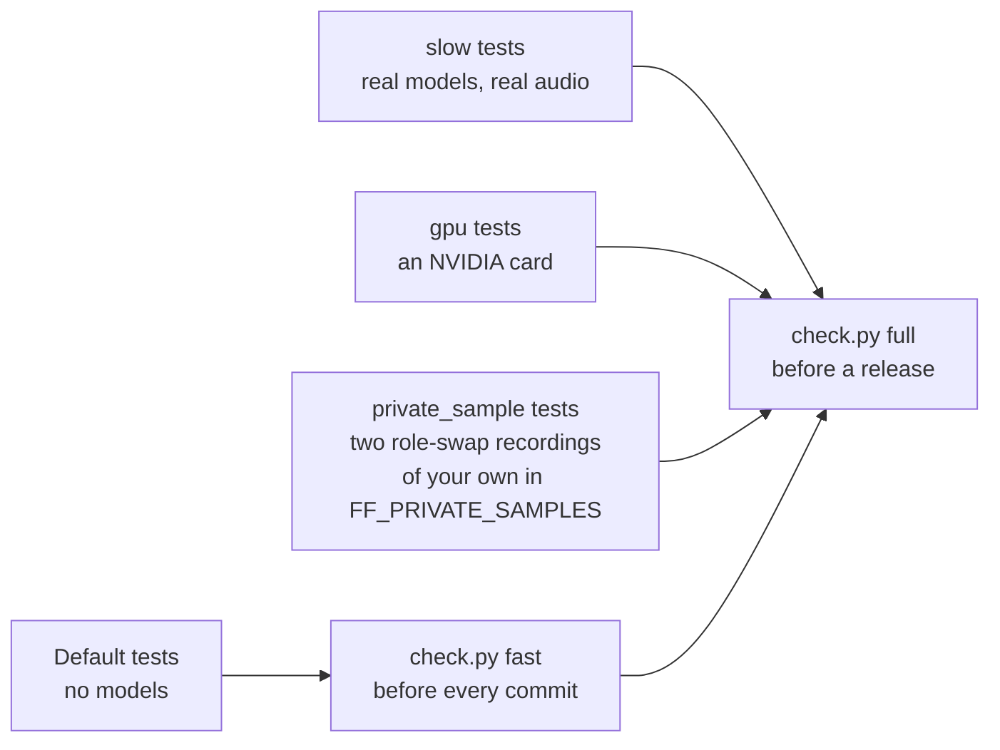
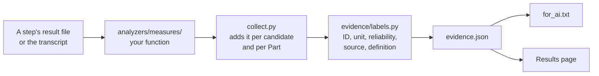

# Development

This page is for people who want to run Fluentfolio from its source code, change it, or add a feature. Read [architecture](architecture.md) first: it explains the parts this page refers to.

**Contents:** [Set up](#set-up) | [Run it from source](#run-it-from-source) | [Tests and checks](#tests-and-checks) | [Code rules](#code-rules) | [Add a feature](#add-a-feature) | [Before you send a change](#before-you-send-a-change)

## Set up

You need Git and [uv](https://docs.astral.sh/uv/). uv installs the right Python (3.12) and every package from the lock file.

```
git clone https://github.com/SacitDev/Fluentfolio.git
cd Fluentfolio
uv sync --locked --extra cpu
```

Use `--extra cu130` instead of `--extra cpu` on a computer with a usable NVIDIA graphics card. Add `--extra nc` only if you accept openSMILE's non-commercial licence.

## Run it from source

Keep your test runs away from a real install by pointing Fluentfolio at folders of your own. In PowerShell:

```
$env:FLUENTFOLIO_APP_ROOT = "C:\ffdev\app"
$env:FLUENTFOLIO_HOME = "C:\ffdev\data"
uv run --locked fluentfolio components install --all --yes
uv run --locked fluentfolio self-test
uv run --locked fluentfolio serve
```

On Linux, use `export FLUENTFOLIO_APP_ROOT=...` and so on. On Windows, the app folder's path must be ASCII, without spaces, under 60 characters, outside OneDrive and on a local NTFS disk (see [architecture](architecture.md#folders-and-locks)). `fluentfolio serve` opens the web app in your browser; every command has `--help` with examples.

## Tests and checks

The test plan, with what each folder proves and where its expected values come from, is in [tests/README.md](../tests/README.md). In short:

| Command | What it runs |
|---|---|
| `uv run --locked python -m pytest` | The default tests, without models, in one process. `tools/check.py fast` runs them on up to 16 workers, which takes about a minute on my computer. |
| `uv run --locked python tools/check.py fast` | Formatting, lint, import layers, types, two bandit rules, and the default tests. Run it before every commit, on an otherwise idle computer: each test worker holds about 1.1 GB of memory, and on Windows a worker can stop with an access violation when other heavy work leaves too little free. |
| `uv run --locked python tools/check.py full` | All of the above with coverage, then the `slow`, `gpu` and `private_sample` tests with real models, the lock check, a vulnerability scan (osv-scanner), unused dependencies, the licence notices, a secret scan of the history (gitleaks) and `shellcheck` on `install.sh`. Install osv-scanner and gitleaks yourself; the other tools come with `uv sync`, and the browser tests need a browser (below). The `slow` tests need more parts than `components install --all` fetches, openSMILE needs the `nc` extra, and one test needs a speech model the app does not offer: [tests/README.md](../tests/README.md#markers-and-skips) explains it. |
| `uv run --locked python tools/fetch_test_data.py` | Downloads the public test data into the folder in `FF_TEST_DATA`, checked against SHA-256. |
| `uv run --locked python tools/selftest_clip.py <LibriSpeech test-clean folder>` | Builds the self-test's bundled clip in `src/fluentfolio/assets/selftest/` again, from two LibriSpeech test-clean speakers. You need it only to change that clip. |

The automatic checks on GitHub also run `shellcheck` on `uninstall.sh`. `.semgrep/fluentfolio.yml` holds Fluentfolio's own semgrep rules. semgrep does not come with `uv sync`, and neither `check.py` nor the automatic checks run it: install it yourself and run `semgrep --metrics=off --config p/python --config .semgrep`. Without `--metrics=off`, semgrep sends usage data to its server when the rules come from there, as `p/python` does.



Four markers exist, and pytest refuses any other: `slow`, `gpu`, `network` and `private_sample`. The default run leaves all four out. The browser tests in `tests/e2e_ui` drive a browser through Playwright: Microsoft Edge on Windows, and Playwright's own Chromium on Linux (`uv run --locked playwright install chromium` gets it). `FF_TEST_STUB=1` replaces the model steps with quick stand-ins (`jobs/stub.py`), so the pages can be tested without models.

Golden files change only on purpose: `pytest --update-goldens` rewrites the ones the selected tests compare. Check the difference before you commit it.

### Both front doors are tested

A learner uses the web app, and an AI agent or a script uses the command line. Both are tested as their users meet them, not only through the code they share.

| What | Where | What the tests do |
|---|---|---|
| The command line | `tests/e2e_cli` | Run the real `fluentfolio` command as a separate process. They check each exit code, the JSON output against its published schema, that no command waits for input without a terminal, Ctrl+C, Turkish and Persian paths on another code page, and that no output shows a recording's words or file name. They also run `check-answer` on saved answers. |
| The web pages | `tests/unit/test_web_*.py` | Call every route through the app's test client. They check the security rules: no page without the session cookie, no other host name, no write from outside the app's own pages, no inline code, no websocket. |
| The pages in a real browser | `tests/e2e_ui` (`slow`) | Drive Microsoft Edge (Chromium on Linux) through Playwright, with the model steps replaced by quick stand-ins. They walk a learner's journeys: the first run, an analysis with live progress, cancel, Copy for AI and the clipboard, the system check's busy button, settings kept after a restart, and the masked token field. They open every page in the light and dark themes at 1280 and 640 pixels wide, with an accessibility check (axe-core), a check for cut-off text and no console error, and they click every control on every page. |
| One core for both | `tests/unit/test_cli.py` | Fails when a public function of `app/facade.py` has no command and is not on the test's list of functions that are not commands themselves, such as the helpers that work out an estimate. |

The browser tests also save a screenshot of every page in both themes, which helps when you review a change to the pages.

## Code rules

- **Layers.** A package imports only from the layers below it. `lint-imports` checks the contracts in `pyproject.toml`.
- **One process starter.** Only `jobs/runner.py` starts processes. Everything else calls it.
- **No network in an analysis.** Steps load models only from the checked local files. The test suite blocks sockets.
- **Files are written whole.** Use `core/files.py` (`write_json`, `atomic_write`), so a crash never leaves half a file.
- **Logs hold no words from a recording.** Log counts, times, codes and step IDs. `core/logs.py` also removes tokens, home paths and user names.
- **Every error has a code** in `core/errors.toml`. Raise the matching class from `core/errors.py` with that code.
- **Types and style.** `ruff format`, `ruff check` and `mypy` must pass. Comments say why, in one to three lines.
- **Plain text.** Comments, docstrings and docs are ASCII. Only data and tests that need another character hold one, such as an IPA symbol or a curly apostrophe to match. The web pages follow a small set of design rules: one column, no score-like visuals, no inline script or style.

## Add a feature

### A new measure



1. Write the calculation as a pure function in `src/fluentfolio/analyzers/measures/`. Return a value from `values.py`: a rounded number, or no number with the reason.
2. Add it in `collect.py`, so it is measured for each candidate, in total and per Part.
3. Give it a label in `evidence/labels.py`: its ID, name, kind (measured, estimated or context), default reliability, source tool, a plain one-line definition, a caveat, and `how`, the few words on how it is measured. Set `details_only=True` for a value that must stay out of the text for AI, such as one an AI might turn into a band rule; it then goes to the evidence's `details` list instead of `measures`.
4. If `evidence.json` gains a field, change `evidence/models.py`, then run the schema test with `--update-goldens` to rewrite `docs/schemas/evidence-v1.schema.json`.
5. Test it with values you worked out by hand, not with the output of the code itself.

The text for AI (`export/for_ai.py`) and the Results page (`web/views.py`) list every entry of the candidate's `measures`, with its definition, so a new measure that is not `details_only` appears in both without its own line. A `details_only` value appears in neither; it stays in `evidence.json` and the ZIP's `details` folder.

### A new pipeline step

1. Write `run(job, progress)` in the package it belongs to. It reads its inputs from the job folder, calls `progress(pct)` now and then, and returns a dict with a `status` (and a `code` if it failed).
2. Add the step ID to `STAGES` in `jobs/stage.py`, with its module, function and result file.
3. Add a `loop.Stage(...)` in `facade.plan()` at the right place, with `required=False` unless every result needs it.
4. Give it a plain title in `STEPS` in `web/views.py`, such as "Finding speech". The progress page shows that title; without one it shows the bare step ID.
5. If it needs a downloaded model, give it a stand-in in `STEPS` in `jobs/stub.py`. The browser tests run with `FF_TEST_STUB=1`, which swaps only the steps listed there (today speech finding, language, speech recognition and speakers) and runs the others for real. If it is slow, add its measured time per audio minute in `doctor/estimate.py` (the `CPU` and `GPU` tables, by step ID), so the New analysis page can say how long a run takes.
6. If it loads a heavy library, check the import contracts in `pyproject.toml`; a library that clashes with another one needs its own process, which a step already has.

### A new downloadable part

1. Add a `[[component]]` to `src/fluentfolio/data/models.toml`: its ID, files, `https://` URLs on an allowed host, SHA-256 hashes, sizes and licence. The catalogue test checks every field.
2. Run `uv run --locked python tools/notices.py` to write `THIRD_PARTY_NOTICES.md` again. It lists every catalogue entry by itself; `--check` (part of `check.py full`) fails when the file is out of date or a licence is unknown.
3. Add a plain one-line explanation to `PART_ABOUT` in `web/views.py`, for the Help page's "The parts" tab. A test fails if an offered part has none.

### A newer version of a package or model

Every download is pinned: Python packages by version and hash in `uv.lock`, models by revision, SHA-256 and size in `models.toml`. To move one to a newer version:

1. A package: `uv lock --upgrade-package <name>`, then `uv sync --locked`.
2. A model: set its `revision` in `src/fluentfolio/data/models.toml` to the new commit. Download each of its files once, and write the new `sha256` and `size` (PowerShell: `Get-FileHash <file> -Algorithm SHA256`; Linux: `sha256sum <file>`). Then run `uv run --locked python tools/notices.py`.
3. Run `uv run --locked python tools/check.py full`. Its `slow` tests analyse the test recordings with the real models.
4. Commit the change on its own, with the old and the new version in the message.

### A new setting

Add a field to the right section in `settings/model.py`, with its default, allowed values, label and help text. The Settings page builds its controls from the model's fields (`web/views.py`), and `fluentfolio settings` reads the same model, so both show it without further work. Read it from the job's settings copy (`job.json`), not from `settings.toml`, so an analysis always uses the settings it started with.

### A new error code

Add a section to `src/fluentfolio/core/errors.toml` with the category (which sets the exit code), severity, title, message, hint, `retryable` and `doc`, then a section with the same title on the [troubleshooting](troubleshooting.md) page. One test checks that every code has its section; another parses every `fluentfolio` command written in a hint with the command line's own parser, so a hint never names a command or option that does not exist.

### A new action

Add a function to `app/facade.py`. Then give it a command in `cli/` and, if a learner needs it, a route in `web/pages.py` with a template. A test checks that every public facade function has its command, or is on its list of functions that are not commands, such as the ones only the web pages use.

## Before you send a change

1. `uv run --locked python tools/check.py fast` passes.
2. A new behaviour has a test that fails without your change.
3. The docs say what the code does: if you changed a default, a limit, a file name or an exit code, update the page that names it.
4. See [CONTRIBUTING](../CONTRIBUTING.md) for how to report a problem or send a change.
