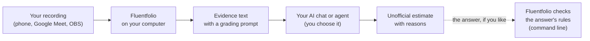
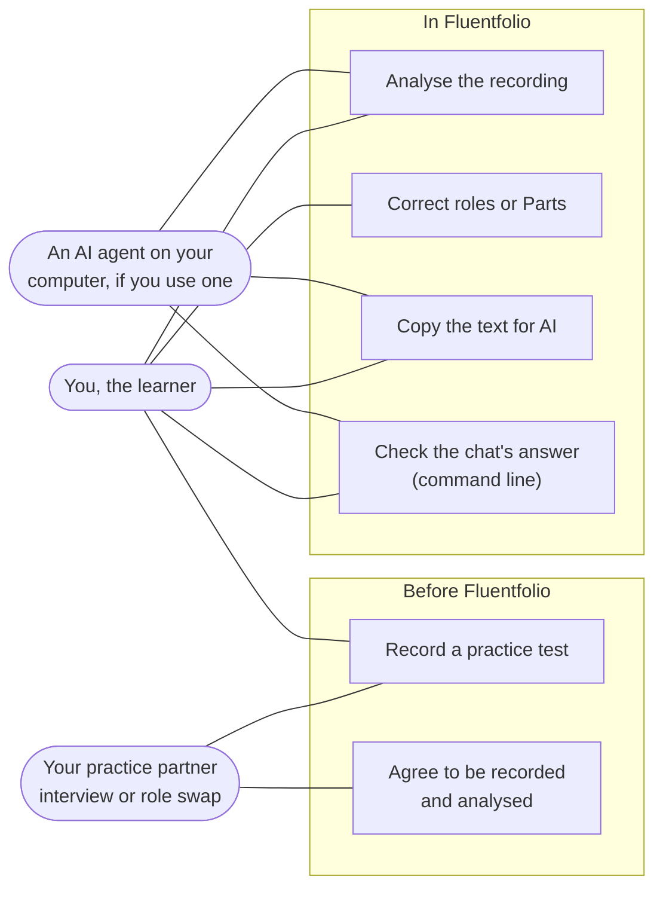
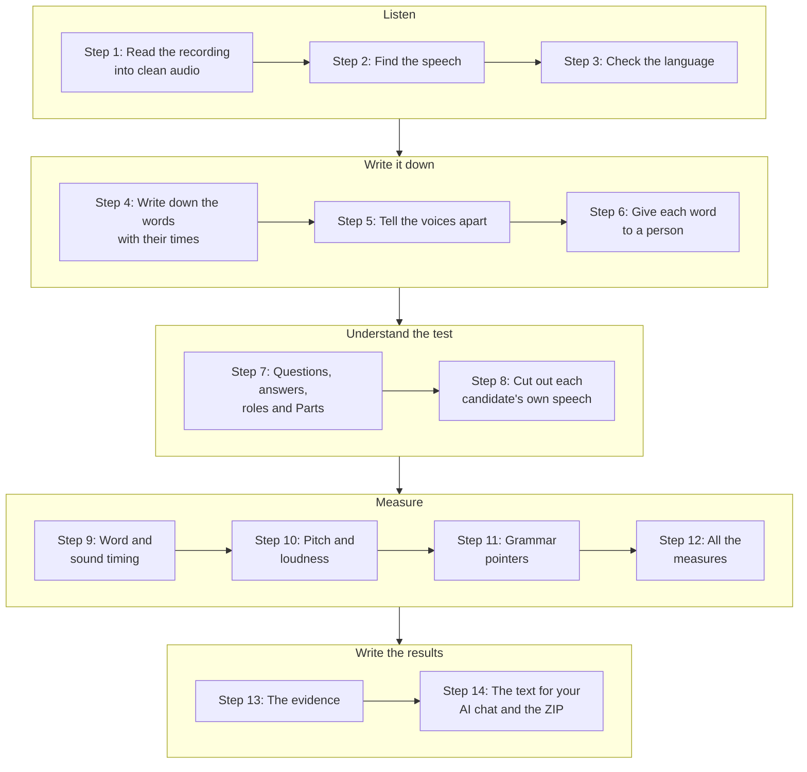
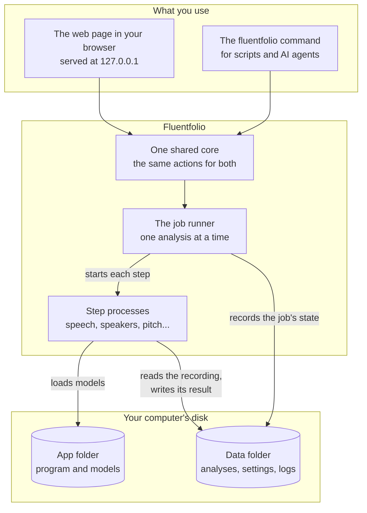
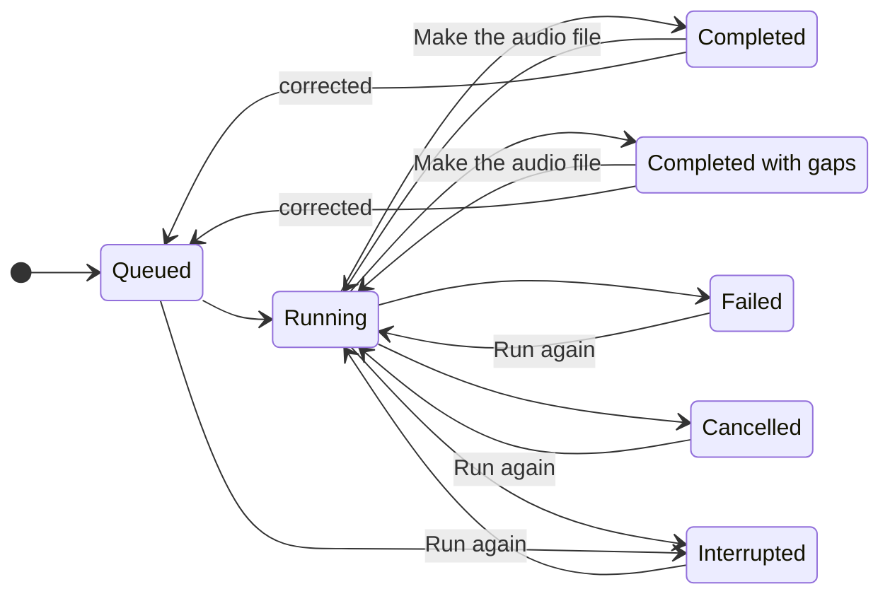
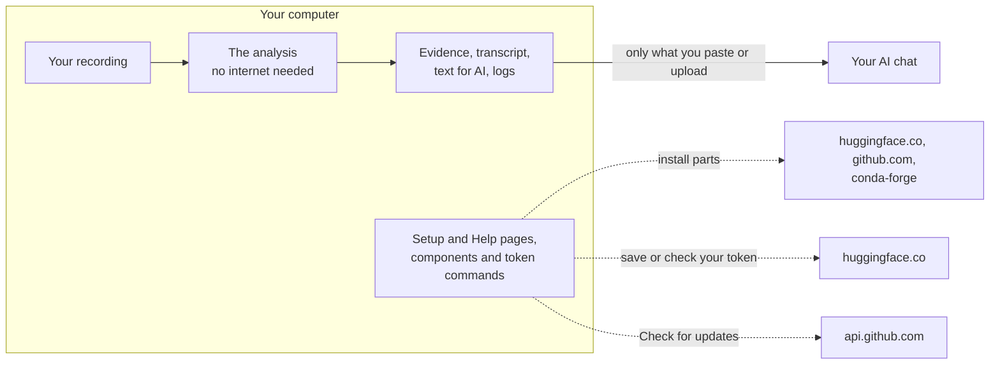

# How Fluentfolio works

This page explains what happens inside Fluentfolio, in plain words, with diagrams. You do not need to know anything about programming to read it.

## The big picture

You record a practice test. Fluentfolio listens to the recording on your own computer and measures how you spoke. It writes what it measured, with instructions for grading, as one text. You paste that text into any AI chat, or let an AI agent on your computer read it, and the AI writes an unofficial estimate. If you like, one command (`fluentfolio check-answer`) then checks that the AI followed the rules.

Fluentfolio never sends your recording anywhere. Only what you give an AI yourself leaves your computer: the text, and if you choose, the ZIP or the audio file of your answers.

## Who does what

An AI agent can run the same steps through the `fluentfolio` command, and, if you ask, write the estimate itself with the same grading prompt and check it. It must ask you for the decisions only you can make: who speaks in the recording, and whether your partner agreed. [Use with AI](use-with-ai.md#three-ways) compares the three ways: the app, the command line and an AI agent.

## The steps of one analysis

When you start an analysis, Fluentfolio runs these steps in order. Each step saves its result, so a stopped analysis can go on from its first step that did not finish.

Some of these words need a short explanation:

- **Speech recognition** (ASR) turns speech into written words, each with the time it was said. Fluentfolio uses Parakeet by default, or Whisper if you choose it.
- **Speaker separation** (also called diarization) works out who spoke when. It uses pyannote if you added your free Hugging Face token, and sherpa-onnx otherwise. If each person has their own track or file, the tracks already say who is who.
- **Forced alignment** finds when each word starts and ends, once the words are known. On 123 test sentences whose true edges were known, the start of the first word and the end of the last word were typically (median) 36 milliseconds off, but about 8 sentences in 100 had an edge more than 0.3 seconds off. The [accuracy](accuracy.md) page has the details. Fluentfolio uses its CTC aligner by default; the MFA aligner is experimental and off unless you choose it.
- **The candidate** is the person answering the questions. In role swap, both of you are candidates, one after the other, and each gets their own evidence.

Steps 3, 5 and 8 to 11 are optional: if a part is missing, switched off or fails, the analysis still finishes, and the results say which measures are missing and why. For example, if step 5 fails on an interview recorded on one track, nobody is given a role, the results say so, and you can set the roles in the review form. Steps 1, 2, 4, 6, 7, 12, 13 and 14 are needed for any result. The command line counts 18 steps, because it lists some of these parts one by one, such as the three tools of step 10.

## The parts of the program

Fluentfolio has two front doors, the web page and the command line. Both call the same inside, so they always behave the same.

Each heavy step runs in its own process. If one step crashes or runs out of memory, Fluentfolio records which one and why, and the rest of the program keeps working. Only one analysis, download or check runs at a time, so two of them never fight over the same files or the graphics card.

## What an analysis goes through

| State | What it means |
|---|---|
| Queued | The analysis is saved and waits a moment for the process that runs it to start. Only one analysis runs at a time: while one runs, Fluentfolio refuses to start another and says so. |
| Running | The steps run one after another. |
| Completed | Every step finished. |
| Completed with gaps | No needed step failed, but a part was missing or failed, a step finished only in part (for example, it could not tell who asked and who answered), or a step used its fallback, such as the processor after a graphics card error, or sherpa-onnx when pyannote cannot run, for example without a Hugging Face token. A part that is off is not a gap: one you switched off, one a light run leaves out, the audio file for an AI chat when you did not ask for it, or openSMILE before you accept its licence. This is still a good result: "Check these results" names a fallback, and "More details: what each step did", under the measures, says which steps failed, were not available or finished only in part, with a reason for some of them. |
| Failed | A needed step failed. The page says which one, why, and what to do. |
| Cancelled | You chose Cancel. |
| Interrupted | Fluentfolio or the computer stopped during the analysis, or the process that runs it did not start within 15 seconds. |

The app shows Queued as "Waiting", Completed as "Finished", Completed with gaps as "Finished, with gaps" and Interrupted as "Stopped".

**Run again** goes on from the first step that did not finish, and keeps the steps before it. **Make the audio file**, on a finished analysis, runs again only the steps that make that file, the evidence and the export. **Corrected** means you saved the review form ("Correct who spoke or where the Parts start"). The analysis then goes back to the queue. It runs again from step 7, or from an earlier step that did not finish, such as step 5 in the example above. The words are written down again only when step 3 did not finish. In an analysis made with "Analyse again in ... mode", Run again and Corrected never go back before the step that analysis started from.

## What stays on your computer

An analysis itself makes no network calls. More in [privacy](privacy.md).

## Edge cases: what happens when...

- **...the recording is very short or very long?** Under 10 seconds it is refused; under 60 seconds the results warn that the measures are less reliable. Over 60 minutes you confirm first, and over 90 minutes you can choose a lighter, faster run. Over 180 minutes it is refused. You can change these limits in Settings.
- **...there is a third voice?** Fluentfolio warns you. A voice that speaks less than 5 % of the time is left out of the evidence.
- **...you chose the wrong mode?** The results page notices common cases, such as a second voice in a solo recording, and offers to analyse again in the right mode without writing down the words again.
- **...it cannot tell who asked and who answered?** It never guesses: it says so, and you can set the roles in the review form.
- **...it cannot find the Parts?** It needs a sign of the long Part 2 answer: topic-card words read aloud before it, or a quiet minute to prepare. Without one, every Part is "unknown", and the text for the AI chat says so. A question list with "Part 1", "Part 2" and "Part 3" lines, or the review form, sets them.
- **...there is music in the background?** A simple check warns you and leaves the music parts out of the pitch and voice measures. It can be wrong.
- **...some speech is not English?** It is marked in the transcript, never removed or translated.
- **...the graphics card fails?** The step runs again on the processor, and the results say so.
- **...the app or the computer stops in the middle?** Run again goes on from the first step that did not finish, and keeps the steps before it.
- **...you close the browser tab?** The analysis goes on. Open Fluentfolio again and find it in History.

The limits of what the measures can tell you are on the [limitations](limitations.md) page, and the numbers behind them on the [accuracy](accuracy.md) page.
