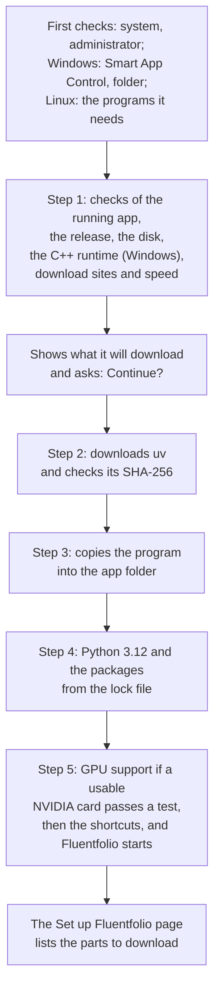

# Install options

Most people only need the two steps in the [user guide](user-guide.md#1-install): extract the release, then double-click `Install.cmd` (on Linux, run `./install.sh`). This page is for everything else: what the installer does, how much it downloads, repairing, updating, removing, and the options for other folders and for testing.

**Contents:** [What the installer does](#what-the-installer-does) | [Sizes and times](#sizes-and-times) | [Repair and update](#repair-and-update) | [Uninstall](#uninstall) | [Options](#options) | [The install log](#the-install-log)

## What the installer does



- **The first checks and Step 1.** The installer stops before it downloads or installs anything when:
  - the computer is not supported;
  - it was started as administrator (or with sudo);
  - Smart App Control is on (Windows 11);
  - the folder for a new install breaks the folder rules, and the other folder it offers cannot be used either (Windows; see `-AppRoot` in [Options](#options));
  - Fluentfolio is running;
  - it finds no release to install;
  - a program it needs is missing (Windows: the Visual C++ runtime; Linux: curl, tar, sha256sum or flock, and unzip when `--source` is a `.zip`);
  - the disk has too little space;
  - one of the download sites it checks cannot be reached.

  Each stop prints the problem, what to do, and a code from [troubleshooting](troubleshooting.md).
- **The question.** It shows the folders it will use, how much it downloads now, the disk space it needs, and how long the download takes at the speed it just measured. To measure that speed, it reads the first 2 MB of the uv file and keeps nothing. Nothing else is downloaded until you answer yes.
- **Step 2, uv.** It downloads [uv](https://docs.astral.sh/uv/), a Python package manager, and checks the file against a SHA-256 hash written in the installer. A repair or an update skips the download when that version of uv is there already.
- **Step 3, the program.** It copies the program from the release folder into the app folder.
- **Step 4, Python and the packages.** uv installs Python 3.12 and every package from the lock file `uv.lock`, which pins each package to one version and one hash. Packages come as ready-made files only, so no package's build script runs on your computer.
- **Step 5, the graphics card and the finish.** With `auto`, the device step looks for an NVIDIA graphics card that Fluentfolio can use. If it finds one, it downloads GPU support (the question before said how much) and runs a short test on the card. If there is no usable card, or the test fails, Fluentfolio runs on the processor, which is slower. Then it adds the shortcuts (Start menu on Windows, the applications menu on Linux) and starts Fluentfolio. Until the check on the page Set up Fluentfolio has passed, Fluentfolio opens on that page. It lists the parts to download, the speech models among them, with the boxes ticked that most people need. Untick what you do not want, then download. An update skips the device step: it keeps what the device step chose before, GPU support or not, and starts the new version once.

While it works, the installer numbers its steps, from "Step 1 of 5" to "Step 5 of 5". The download of uv shows a bar. The packages come as one bar too, counting their large files, which make up most of the download: it shows the share done, the size, the speed and the time left. When the installer's output goes to a file instead of a window, it writes plain lines instead of bars.

The installer installs for your user only. It needs no administrator rights, adds nothing to your PATH, and writes only into the app folder, the data folder and the shortcuts.

## Sizes and times

These are the numbers the installer shows, and what my test installs measured. The models come later, on the Set up Fluentfolio page.

| | Windows | Linux |
|---|---|---|
| Download for the program (uv, Python 3.12 and the packages) | about 0.5 GB | about 0.7 GB |
| GPU support, if a usable NVIDIA card is found | about 2.7 GB more | about 3.7 GB more |
| The models ticked at first | about 4.4 GB | about 4.4 GB |
| Disk space for the program | 1.7 GB measured (the installer asks for 3 GB free while it unpacks) | about 2.1 GB: the 8.6 GB below less the 6.5 GB of GPU packages (the installer asks for 3 GB free) |
| Disk space with GPU support | 5.5 GB measured | 8.6 GB measured |

A full Windows test install with GPU support took about 18 minutes on a 3 MB/s connection: about 5 minutes for the program and about 12 for GPU support. A Linux test install (Ubuntu 24.04 in WSL) took about 73 minutes on a connection near 1 MB/s: about 8 minutes for the program and about 66 for GPU support, whose CUDA packages are larger on Linux. The models came after that. The time line on the installer's screen is only the download time at the speed it measured. Unpacking, and download servers slower than the first one, can double or triple it.

## Repair and update

**Repair.** Run the installer again from the same release folder. It says "will be repaired", downloads only what is missing, and keeps your settings, analyses and models. Its device step runs again with the `-Device` option (Linux: `--device`), which is auto unless you give it (see [Options](#options)).

**Update.** Download the newest release from the [releases page](https://github.com/SacitDev/Fluentfolio/releases), extract it into a new folder, and run its installer. It says "will be updated from" the old version. Your recordings, results, settings and models are kept. If the new version fails before it is ready, the old one stays in use and still works (`E_UPDATE_FAILED_OLD_KEPT`).

`Update.cmd` (in the app folder on Windows) and `./install.sh --update` only print these steps and open the releases page; they download nothing themselves. The Help page's **Check for updates** button asks GitHub for the newest version number.

Close Fluentfolio before a repair or an update. If the installer finds it running, it stops with `E_APP_RUNNING`.

## Uninstall

- **Windows:** in the Start menu, choose **Uninstall Fluentfolio**. Or open PowerShell from the Start menu and run `powershell -NoProfile -ExecutionPolicy Bypass -File "$env:LOCALAPPDATA\Fluentfolio\uninstall.ps1"`. If your app folder is another one, for example `D:\Fluentfolio`, write that folder in both places: `-File "D:\Fluentfolio\uninstall.ps1" -AppRoot D:\Fluentfolio`.
- **Linux:** run `./uninstall.sh` in the app folder (`~/.local/share/fluentfolio`). If you installed into another folder, add `--app-root` and the full path of that folder.

The uninstaller shows the size of the app folder and asks before it removes it. Then it asks about each thing that belongs to you: your recordings and results, a models folder you moved out of the app folder, and the Hugging Face token. It asks about the token only if Fluentfolio saved it and the program is still there. A models folder inside the app folder goes with the program. Each one of yours stays unless you type Y. If a folder you keep lies inside a folder you say yes to deleting, it stops and removes nothing. With `-Yes` (Linux: `--yes`) it asks nothing: the program goes, and everything of yours stays. On Windows, when you start it from the Start menu, its window stays open at the end until you press Enter, so you can read how it ended.

Close Fluentfolio first. If the uninstaller finds it running, it stops with `E_APP_RUNNING`.

## Options

On Windows, open PowerShell in the extracted release folder and run, for example:

```
powershell -NoProfile -ExecutionPolicy Bypass -File .\install.ps1 -Device cpu
```

On Linux, add the options after `./install.sh`, for example `./install.sh --device cpu`.

| Windows | Linux | What it does |
|---|---|---|
| `-Device auto\|gpu\|cpu` | `--device auto\|gpu\|cpu` | auto (the default) uses a usable NVIDIA graphics card and the processor otherwise. cpu never adds GPU support to an install without it. A repair first installs the packages the device step chose before, then runs the device step again with this option, so a repair without it uses auto. An update ignores this option and keeps what the device step chose before. |
| `-AppRoot <folder>` | `--app-root <folder>` | Install into another app folder. On Windows the path must be ASCII, without spaces, outside OneDrive, under 60 characters and on a local NTFS disk, because some speech tools fail otherwise. When the folder for a new install breaks these rules, the installer offers the `-FallbackRoot` folder instead. |
| `-FallbackRoot <folder>` | (none) | Windows only: the folder offered when the usual one cannot be used, for example because your user name has letters outside A to Z. `C:\Fluentfolio` unless you say. The installer asks first and makes it readable only by you. |
| `-Source <folder or .zip>` | `--source <folder or archive>` | Install from another release folder or a release archive (Linux: `.tar.gz`, `.tgz` or `.zip`) instead of the installer's own folder. |
| `-Yes` | `--yes` | Answer every question with yes and do not start the app at the end. It never accepts openSMILE's licence, because only you can. For scripts and tests. With `-Update` it does not open the releases page. With `-Uninstall` it removes only the program and keeps everything of yours. |
| `-PreflightOnly` | `--preflight-only` | Run only the checks, then stop with "Preflight passed." Apart from the 2 MB speed test, which is not kept, nothing is downloaded. |
| `-Update` | `--update` | Print the update steps and open the releases page. |
| `-Uninstall` | `--uninstall` | Run the uninstaller. |
| `-AllowElevatedTest` | (none) | Windows only, for the installer's own tests: lets it run as administrator. Do not use it to install. |

The data folder is chosen by the app, not by the installer. To keep it somewhere else from the start, set the `FLUENTFOLIO_HOME` variable before you install and every time you start Fluentfolio, or move the folder later in Settings, on the Advanced tab. Choose a folder outside the app folder, because the uninstaller deletes the app folder with everything in it. Settings does not move the data folder there, and the uninstaller stops and removes nothing while a data folder you keep lies inside it. If you set the variable only in one PowerShell window, run the uninstaller from that window too (see Uninstall above): the Start menu does not see it.

## The install log

Every install writes `logs/install.log` in the app folder (Windows `%LOCALAPPDATA%\Fluentfolio\logs\install.log`, Linux `~/.local/share/fluentfolio/logs/install.log`). It holds the steps, the tools' messages and folder names, but no recordings. Read it before you share it when you ask for help.
