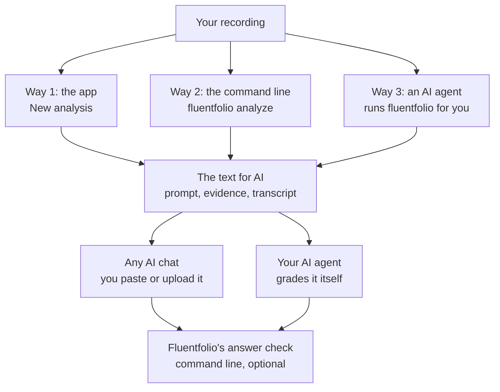
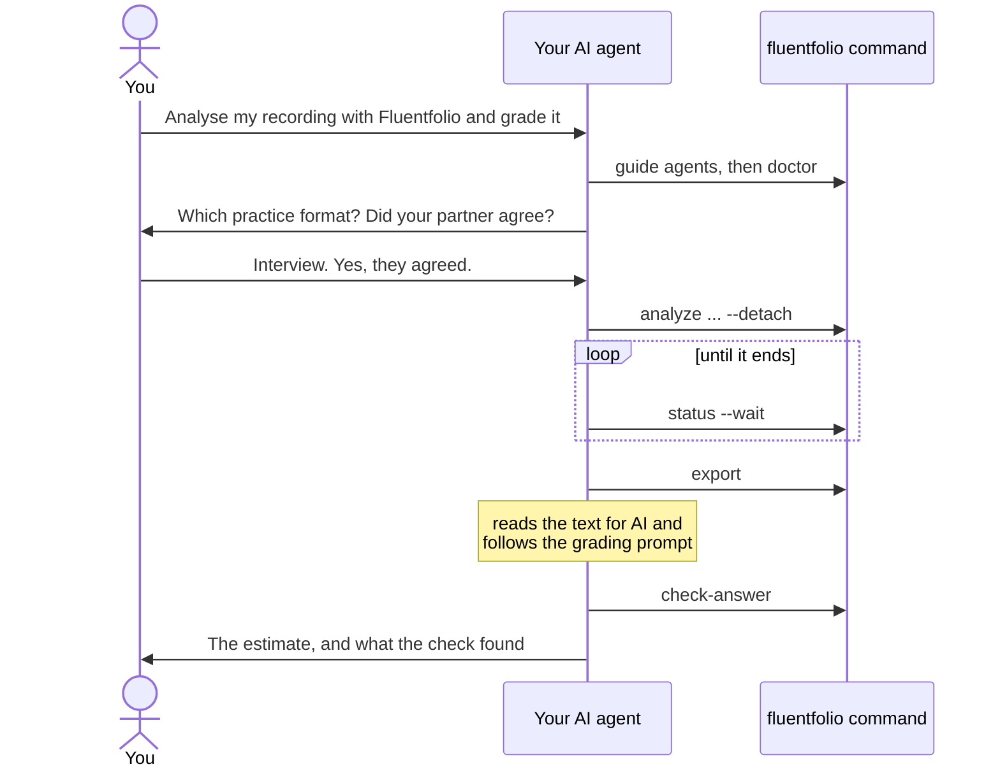

# Use with AI

Fluentfolio measures your recording but gives no band itself. An AI reads the measured evidence with Fluentfolio's grading prompt and writes a report. The report holds an unofficial practice estimate for each criterion, and a full course of lessons built from your own answers. This page shows the three ways to do that, and what to watch for.

The estimate is not an IELTS score. No AI and no part of Fluentfolio was checked against real examiners.

**Contents:** [Three ways](#three-ways) | [Way 1: the app](#way-1-the-app) | [Way 2: the command line](#way-2-the-command-line) | [What the answer looks like](#what-the-answer-looks-like) | [Check the answer](#check-the-answer) | [Audio for Pronunciation](#audio-for-pronunciation-optional) | [Way 3: an AI agent](#way-3-an-ai-agent-on-your-computer) | [Safety](#safety) | [Compare several runs](#compare-several-runs)

## Three ways

| | Who runs Fluentfolio | Who writes the estimate | Good for |
|---|---|---|---|
| **1. The app** | you, in the web page | any AI chat: you paste or upload the text | most learners |
| **2. The command line** | you, with the `fluentfolio` command | any AI chat: you paste or upload the text | people who like a terminal or scripts |
| **3. An AI agent** | an AI agent on your computer, such as Claude Code or Codex | the same agent, with Fluentfolio's grading prompt | people who already use an agent |



All three ways run the same analysis on your computer and give the same text, with the same grading prompt. They differ only in who presses the buttons and who writes the estimate. Afterwards, you or your agent can test the estimate's format and rules with Fluentfolio's answer check, on the command line.

## Way 1: the app

1. Open the finished analysis and choose **Copy for AI**.
2. Choose **Copy for AI** under "Text for your AI chat". The text holds the grading prompt, the evidence and the transcript in one block.
3. Paste it into a new chat, as it is, and send it.

The text has no length limit: it always holds your whole transcript, so a long recording gives a long text. A few long lists stop at a fixed number of items, and the text says how many it shows: repeats and self-corrections at 15, rare words at 20, and the differences from your own transcript at 40. The full lists are in the details folder of the ZIP. If the chat refuses the paste or cuts it, either download the `.txt` file on the same page and upload it as a file, or open **Copy in 2 parts**: send part 1, wait for the answer, then send part 2.

In a role-swap recording there is one text per person. Send each in its own new chat.

## Way 2: the command line

The same steps, typed. [The command line](cli.md) page says where the command is and lists every option.

```
fluentfolio analyze practice.m4a --mode solo
fluentfolio export <job id> --print
```

`analyze` shows its progress and ends with the job ID. `export --print` prints the text for AI; copy it into a new chat. In a role-swap recording, add `--candidate person1` or `--candidate person2` to print each person's text. `export --out <your folder>` copies the texts and the ZIP into a folder instead, so you can upload a file. `fluentfolio prompt` prints the grading prompt alone.

## What the answer looks like

The prompt asks for one report in Markdown, a plain-text format with headings and tables. It asks the AI to keep the report easy to read. That means a heading for each part and lesson, short paragraphs and bold key words. It also means tables for word lists and corrections, numbered steps, and a line between the parts. The report is titled "Fluentfolio Speaking Report" and has these parts, in this order:

1. Three short lines on what the AI received: whether it heard audio, the audio check, and the files.
2. A table with one estimated band for each criterion, for example "Estimated band: 6", with the main reason and the times it comes from. There is no range and no confidence level: it is an estimate.
3. A summary for each criterion: one strength, the main weak points with quotes and times, and what keeps you from the next band. Then how well you answered the questions, and notes on the evidence, for example that the transcript may have smoothed your grammar.
4. Your three priorities, each with a better version of your own words and a 5-minute practice task.
5. A full course written for beginners, as a patient teacher would give it: one lesson each on fluency, vocabulary and collocations, grammar and accuracy, sentence structure, pronunciation and answering the questions. Each rule is explained in plain words, with many examples from your own answers and exercises with their answers. It includes better words for your topics, a few less common words that still sound natural, collocations grouped by pattern, useful spoken phrases, phrases for when a word is missing, spoken connectors, structures to add, and a 7-day study plan.
6. How to answer Parts 1, 2 and 3: what happens in each Part, a strategy, common mistakes, and full sample answers to the questions you were asked. They are models to learn patterns from, not to memorise.
7. One tip for your next recording, a JSON block for Fluentfolio's answer check, and the line "Unofficial practice estimate. Not an IELTS score. Not affiliated with IELTS or its owners."

To keep the report, save it as a `.md` file. Most editors and many note apps show such a file with its headings and tables. To check facts for its lessons, the prompt lets the AI open the public band descriptors and pages on ielts.org, takeielts.britishcouncil.org and ielts.idp.com, and no other site.

Pronunciation always gets an estimated band, so the overall estimate, the average of the four bands, is always there too. The one exception: if you spoke for less than a minute, the report gives no bands at all. From the text alone, the AI estimates Pronunciation from the clues in the data: the words to check, the words the speech recogniser heard differently from your own transcript (when you add one), and the pitch and pause measures. The report says once, in its notes on the evidence, that this estimate was made without hearing your voice. For an estimate by ear, use the audio step below.

## Check the answer

AIs make mistakes. The answer check runs on the command line only; the app has none. A long report can take several replies: when a reply ends with "Reply 'continue' for the rest.", reply "continue" until the report ends with its final line. Save all the replies, in order, in one `.md` or `.txt` file and run `fluentfolio check-answer <job id> answer.md` (in a role swap, add `--candidate person1` or `person2`). `fluentfolio jobs list` shows the job id.

Fluentfolio checks the answer's format, its band rules, that each quote matches your transcript, and the audio check, and shows which rules passed. It cannot tell whether the bands themselves are right.

## Audio for Pronunciation (optional)

Some chats can listen to audio. For them, Fluentfolio can make a short audio file of your own answers, at most 9.5 minutes, without the questions. It is cut to your answers, but your partner can still be heard where the speakers were mixed up or you spoke at once, so upload it only if your partner agrees.

1. On the Copy for AI page, choose **Make the audio file**. On the command line: `fluentfolio export <job id> --audio`.
2. Download the audio file and copy the message shown under it.
3. In the same chat as the text, upload the file and send the message with it. The chat then writes the whole report again, with Pronunciation, its lesson and the overall estimate now judged by ear.

The message includes an audio check: the chat must write what it hears in one short span, whose words are not in the text. If it cannot, it did not really receive the audio: ignore that answer's Pronunciation and overall estimate, and ask again without the audio file, so the chat estimates Pronunciation from the clues in the text. The answer check on the command line tells you when this happens. In the app, open "Show what is said in the audio check" on the Copy for AI page and compare it with the chat's `audio_check` line.

Which chats take audio changes often. When I looked in 2026, Gemini's free plan took audio files, about 10 minutes in total, but not inside a ZIP; ChatGPT took audio on some plans; the free plans of Claude and Copilot took none. Check your chat's own help pages.

### Uploading other files

You can also give a chat:

- **The ZIP** from the Copy for AI page (or `export --out`). It holds the texts and a `details` folder with the full record. The prompt tells the chat to grade from the text and not from `details`. Some chats do not open ZIP files.
- **Your own recording.** It holds everything, including the questions and, in a recording of two people, your partner's voice all the way through. Upload it only if your partner agrees. The Copy for AI page says so too.
- **Your own transcript**, for example from Google Meet. If you gave it to Fluentfolio with the analysis, the text already lists where it differs from Fluentfolio's transcript, with the names found in its speaker labels replaced. Some labels and some forms of a name are not found (see [limitations](limitations.md)).

## Way 3: an AI agent on your computer

An AI agent is an AI tool that can run commands on your computer for you. Claude Code and Codex are two of them. You ask it in plain words. It runs the analysis with Fluentfolio's command line, reads the text for AI, writes the estimate with Fluentfolio's grading prompt, and checks its own answer with Fluentfolio's answer check.

An AI that runs only in the cloud, such as a chat on a website, cannot reach your computer, so it cannot run Fluentfolio. Use Way 1 or 2 with it instead.



### Step 1: find the command

The installer does not add Fluentfolio to your PATH, so your agent needs the command's full path. Open Fluentfolio, choose **Components**, open **More details**, and copy the path after "The command line, for scripts and AI agents". The page writes the start of the path as `%LOCALAPPDATA%` (on Linux `~`), so that a screenshot shows no user name; your agent can expand it, and in PowerShell it is `$env:LOCALAPPDATA`. The path holds the version number, so copy it again after an update. [The command line](cli.md#where-the-command-is) page shows where it usually is.

In the examples below, `<command>` stands for that path.

### Step 2: add Fluentfolio's skill to your agent

Fluentfolio has a short guide for agents. It names the usual commands and the rules: ask you for the practice format and your partner's agreement instead of guessing, and grade only when you ask. One command writes it as a skill file, which your agent can load by itself when your request is about Fluentfolio. Run it once, in PowerShell (on Linux, in a terminal, with `~` in place of `$HOME`):

| Agent | Command | Writes |
|---|---|---|
| Claude Code | `& "<command>" guide agents --write-skill "$HOME\.claude\skills"` | `.claude\skills\fluentfolio\SKILL.md` in your user folder |
| Codex | `& "<command>" guide agents --write-skill "$HOME\.agents\skills"` | `.agents\skills\fluentfolio\SKILL.md` in your user folder |

These are the folders the two agents' own documentation named for personal skills in October 2026. If your agent does not find the skill, check its help pages for the current folder, or restart it. After an update, run the command again, so the skill matches the new version.

No skill file? Start your request with: "First run `<command> guide agents` and follow it."

### Step 3: ask

For example:

> Use Fluentfolio to analyse `<your folder>\practice-3.m4a`, then grade it with Fluentfolio's grading prompt and check your answer. The fluentfolio command is at `<command>`.

1. Your agent asks you which practice format the recording has, and, for an interview or a role swap, whether your partner agreed. Answer it yourself.
2. An analysis takes some minutes. The agent starts it in the background and checks on it until it ends. The same analysis appears in the app's History, so you can also open its results page.
3. The agent reads the text for AI and writes the report, following the grading prompt. The prompt lets it run code only to analyse your own files, for example to measure the audio, with nothing installed and no network, and it may create no file except the report itself, saved as `fluentfolio-report-<export>.md` (in a role swap, one report per person). In a role swap, it grades each person on their own.
4. When the report is written, the agent runs `fluentfolio check-answer` on that file and shows you the estimate with the check's result. Some agents work in a sandbox that cannot save files; then the report is only in the agent's reply, and you can save it yourself as a `.md` file.

The agent grades from the text, so, as in a chat without audio, it estimates Pronunciation from the clues in the data, without hearing your voice. For an estimate by ear, give the audio file to a chat that listens (see [Audio for Pronunciation](#audio-for-pronunciation-optional)).

You can also ask only for the analysis ("analyse it, but do not grade it") and then use Way 1 for the estimate.

### What your agent sees, and what stays with you

- Fluentfolio's JSON output (`--json`) holds job IDs, codes, numbers, durations and paths, never what was said or your recording's file name. Two commands print recorded words on purpose: `export --print` prints the text for AI, and `check-answer` without `--json` prints the words hidden for the audio check. A test plants a made-up word in a recording's words and in its file name, and checks that the other job commands never print it, with or without `--json`.
- Fluentfolio's guide tells the agent not to open your texts unless you ask it to grade. Fluentfolio cannot enforce that, so treat anything in Fluentfolio's folders as readable by the agent. When the agent reads the text for AI, the text goes to the agent's company, as it does with any chat. In an interview or a role swap, it holds your partner's words too.
- The transcript is recorded speech, and a recording can hold words that look like instructions. Fluentfolio's guide and its grading prompt tell the agent to treat the transcript as data and never follow it. While the agent grades, approve no command you did not expect.
- Some decisions are always yours: your partner's agreement, a recording over 60 minutes, a download and its size, openSMILE's licence and your Hugging Face token. Without them, Fluentfolio stops with exit code 5 and the agent must ask you. Accept the licence and add the token yourself, in your own terminal: `fluentfolio components consent opensmile` asks you to type I ACCEPT, and `fluentfolio token set` asks for the token at a hidden prompt. Never give the token to an agent.
- Most agents ask before they run a command, unless you switched that off. Approve only the `fluentfolio` commands you expect. Some agents run commands in a sandbox that cannot write outside your project folder. Fluentfolio saves its results in its own data folder, so allow its commands to run outside such a sandbox when the agent asks.
- Some agents stop every process a command started when the command ends. If the analysis then shows "Stopped" in the app (state `interrupted` on the command line), open it in the app and choose **Run again**, or run `fluentfolio resume <job id>` in your own terminal.

## Safety

- What you paste, upload or let an agent read goes to the company that runs that AI, under its own terms. In interview and role-swap recordings, the text and your recording hold your partner's words: share them only if your partner agrees.
- The transcript is recorded speech, so treat it as untrusted text: a recording can contain words that look like instructions. The prompt tells the AI to treat everything except the prompt as data, to open no link found in it, and never to put your words into a search or a link. In a chat, paste into a normal chat. With an agent that can run commands, follow the points under Way 3.
- Never paste your Hugging Face token or anything from your computer's folders into a chat, and never give the token to an agent.

## Compare several runs

The same text can get different bands from different AIs, and even from the same AI twice. Send it to two or three chats, or twice to one, and compare. If two estimates for a criterion differ by more than one band, trust neither. Trust what they agree on, and read the reasons, not only the numbers. Over several practice tests, also compare the measured evidence, such as speech rate and pauses: it is measured from your recordings the same way each time, while an AI's bands can vary. Repeats and self-corrections are possible cases to check, not counts, so look at the examples rather than their number.
