# User guide

This guide takes you from the download to your first estimate from an AI chat. Each page of the app also explains itself in a line or two, and the app's **Help** page has the short version of this guide.

**Contents:** [Install](#1-install) | [Set up the parts](#2-set-up-the-parts) | [The Hugging Face token](#3-the-hugging-face-token-optional) | [Your first analysis](#4-your-first-analysis) | [Read the results](#5-read-the-results) | [Correct the roles or the Parts](#6-correct-the-roles-or-the-parts) | [Copy for AI](#7-copy-for-ai) | [Privacy in short](#8-privacy-in-short) | [Settings](#9-settings) | [Update and uninstall](#10-update-and-uninstall)

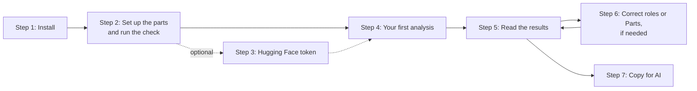

## 1. Install

You need Windows 10 22H2 or later, Windows 11, or Ubuntu 22.04 or 24.04, on a 64-bit Intel or AMD processor, and an internet connection for the install. Fluentfolio installs for your user only and never needs administrator rights.

**Windows**

1. On the [releases page](https://github.com/SacitDev/Fluentfolio/releases), download the newest release (the Source code zip).
2. Right-click the downloaded file, choose "Extract All", and open the extracted folder.
3. Double-click `Install.cmd`. A window opens and checks the computer first: the Windows version, Smart App Control, the free disk space and the download sites.
4. It shows where it will install, how much it downloads now (about 0.5 GB, and about 2.7 GB more for a usable NVIDIA graphics card) and how long the download takes at your connection's speed. Type `Y` and press Enter.
5. When it says "Ready", Fluentfolio starts and opens in your browser. Later, start it from the Start menu: **Fluentfolio**.

**Linux**

1. Download and extract the newest release as above.
2. In a terminal, in the extracted folder, run `./install.sh` (never with sudo).
3. Start Fluentfolio later from your applications menu, or run the `fluentfolio` command shown at the end.

If the installer stops, it says why and what to do, with a code that [troubleshooting](troubleshooting.md) explains.

**Smart App Control.** On some Windows 11 computers, Smart App Control is on. It blocks programs that are not signed by a known publisher, and Fluentfolio's speech tools are not, so Fluentfolio cannot run while it is on. The installer checks this before it downloads anything and never changes the setting itself. Read [E_SAC_ENFORCED](troubleshooting.md#e_sac_enforced) before you decide anything.

**The Fluentfolio window.** Fluentfolio runs in a small window titled "Fluentfolio: keep this window open", and you use it in your browser. Keep that window open while you use the app. To stop Fluentfolio, close the window, or choose Quit in the app.

## 2. Set up the parts

On the first start, the **Set up Fluentfolio** page lists the parts, each with its download size and licence, in groups by what they do. The main ones:

- **Writing down the words**: the speech recognition (ASR) models, which turn speech into words with their times;
- **Telling the voices apart**: speaker separation (also called diarization);
- **Timing each word**: the aligners, which do forced alignment: they match each word of the transcript to the exact time it was said;
- **Measuring pitch, voice and loudness**, **Listening to the sounds of words** and **Finding sentence structures**: the measuring tools.

| Light | Dark |
|---|---|
| 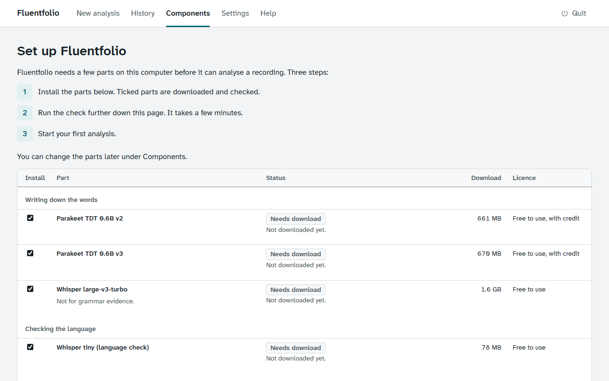 | 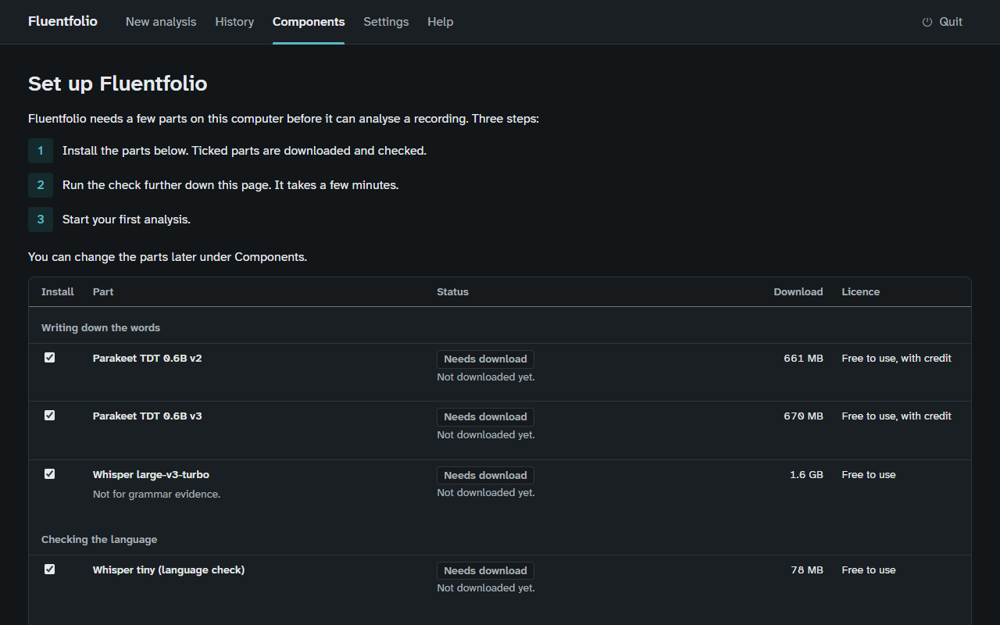 |

1. Leave the ticked parts as they are, or untick what you do not want, then choose **Install selected**. The total size of the ticked parts is shown under the table. While the parts download, a bar shows the share done, the speed and the time left.
2. When the install is done, choose **Run the check**. It runs a short recording that comes with Fluentfolio through every part and compares the results with known values. It takes a few minutes.
3. When the check passes, choose **Start analysis**.

You can add or remove parts later on the **Components** page.

**The MFA aligner** is not ticked by default: it did not pass its word-timing check (see [accuracy](accuracy.md)). If you install it anyway, it needs about 2.6 GB more on disk: about 2.5 GB for its own Python environment and 0.1 GB for its models.

**openSMILE** measures loudness. Its licence allows non-commercial use only, so it waits until you read the licence on the Components page and tick that you accept it for your own non-commercial use. Then close Fluentfolio and run the installer again, which adds it.

## 3. The Hugging Face token (optional)

To tell two voices apart, Fluentfolio uses pyannote when it can. pyannote is free, but its makers ask each user to accept its terms, so it needs your own free Hugging Face account and token. You can skip this step: without a token, Fluentfolio uses sherpa-onnx, and solo recordings need neither. With the default speaker separation, a recording of two people on one track then finishes "with gaps", with a note that the speakers were told apart without pyannote.

1. On the Components page, in the pyannote row, choose **Add your token**.
2. Make a free account at [huggingface.co](https://huggingface.co).
3. On the token page, open **the model page** and accept its terms.
4. Open **your token settings page** and choose **Create new token**. Choose the **Read** token type, type any name (for example `fluentfolio`), and choose **Create token**. Copy the token: it starts with `hf_`. (These are the button names on Hugging Face's site in October 2026; they may change.)
5. Paste it into **Token** on Fluentfolio's token page and choose **Save token**. Fluentfolio checks it with Hugging Face and says whether it works and whether the terms are accepted.

The token is saved by Hugging Face's own tool in its usual place, never in Fluentfolio's files. **Remove token** removes it again.

## 4. Your first analysis

On **New analysis**:

1. **Recording**: choose the audio or video file of your practice test. Fluentfolio shows its length, size and format, and how long each mode will take on this computer.
2. **Who speaks**: Solo (only you; you read or play the questions), Interview (someone asks you) or Role swap (two learners take turns). Each choice shows a small diagram of who speaks when.
3. For interview and role swap: **How it was recorded** (one recording of everyone, one track per person, or two files), and tick that the other person agreed to be recorded and analysed on this computer. For role swap, also choose when the roles change.
4. Optional: under **Add the questions or your own transcript**, paste the questions you were asked, one per line, or your own transcript.
5. Choose **Start analysis**.

| Light | Dark |
|---|---|
| 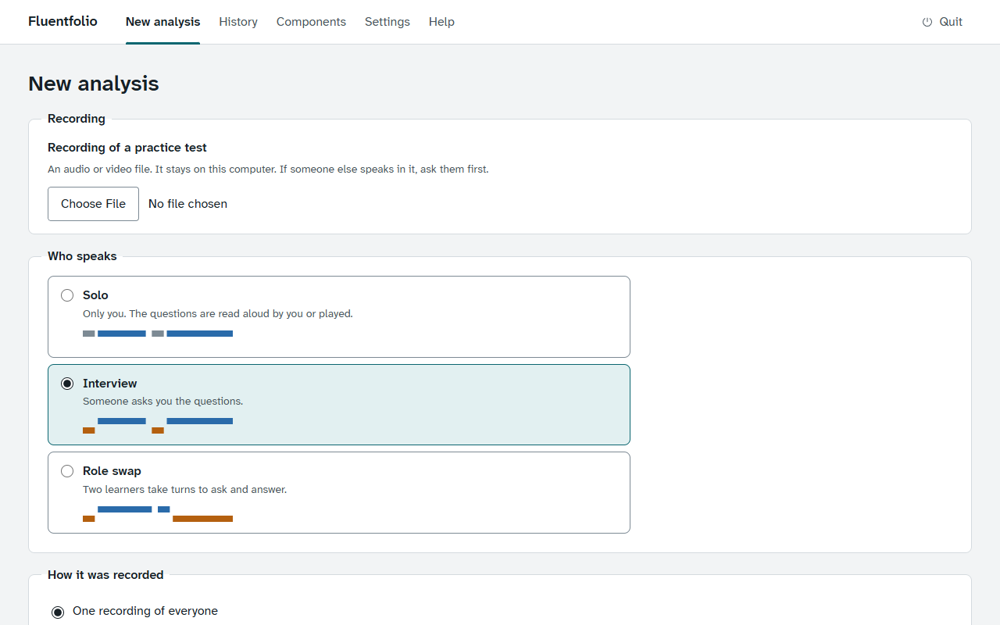 | 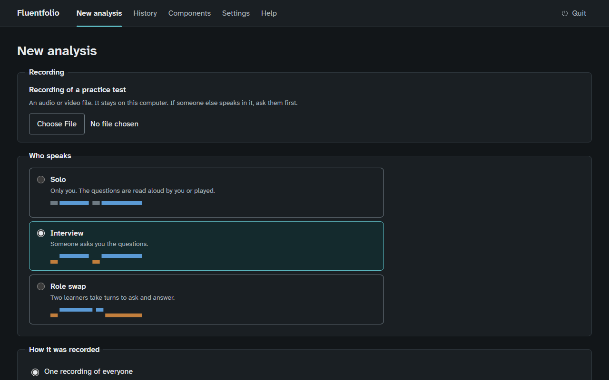 |

**Who speaks (the mode).** Who talks, and in what order:

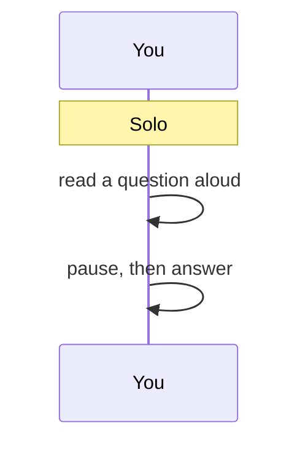

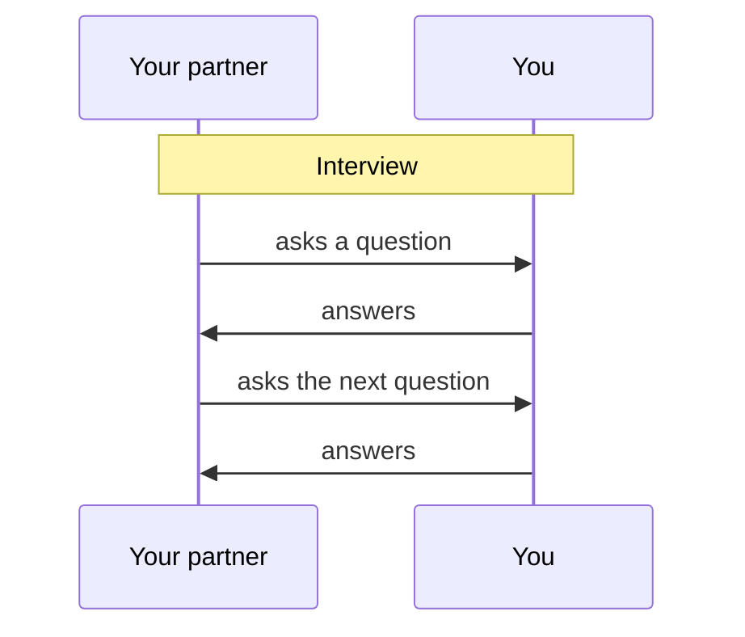

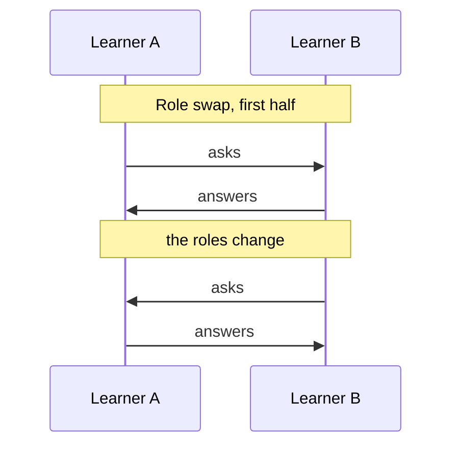

**How it was recorded (the layout).** How the voices reach Fluentfolio:

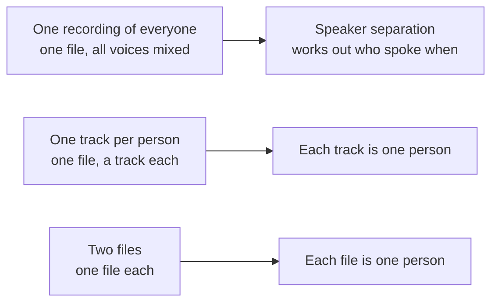

One track per person and two files are the most accurate, because no guessing is needed. The [recording guide](recording.md) explains the modes and layouts in detail, with the settings for common apps.

The analysis page shows each step as it runs. You can leave the page and come back: the analysis goes on, and **History** lists it. **Cancel analysis** stops it and keeps the finished steps; **Run again** goes on from the first step that did not finish.

A recording over 60 minutes asks you to confirm first, because it takes long. Over 90 minutes you can choose a light run, which leaves out the slowest steps.

## 5. Read the results

| Light | Dark |
|---|---|
| 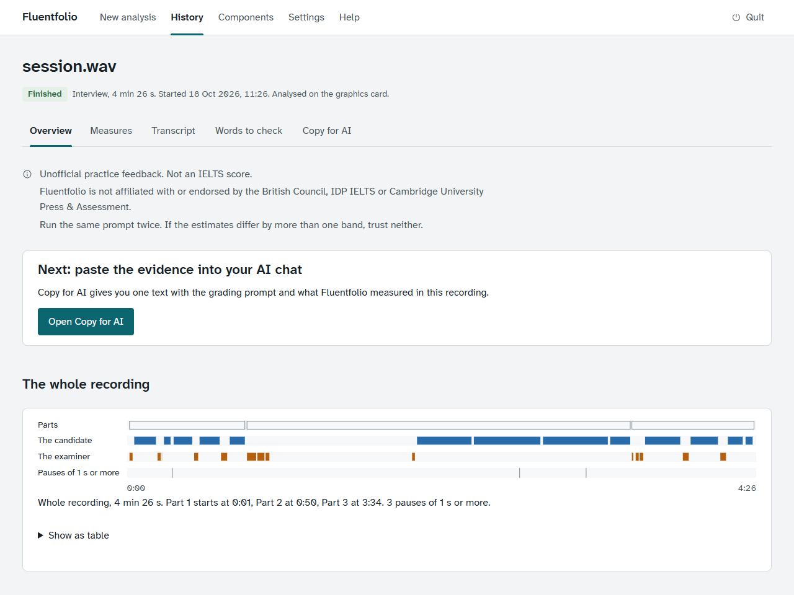 | 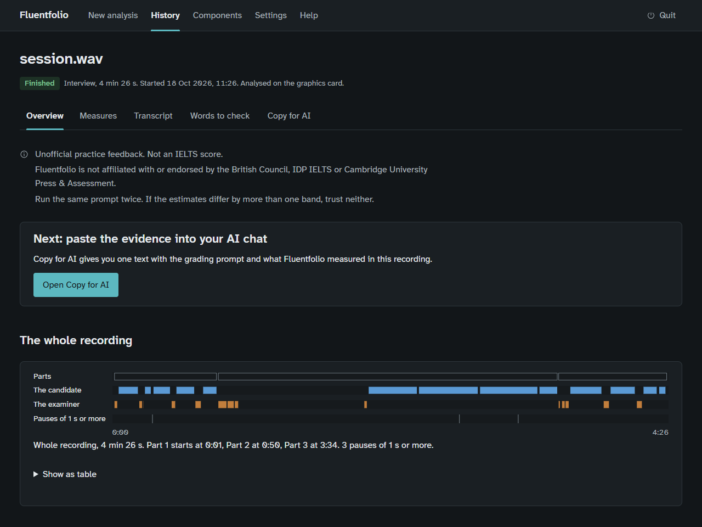 |

The analysis page has:

- **Check these results**: anything that limits this analysis, for example a third voice, or a second voice in a solo recording, sometimes with a button to analyse again in another mode.
- **Next: paste the evidence into your AI chat**, with **Open Copy for AI**.
- **The whole recording**: a strip of who speaks when, with the Parts. **Show as table** gives the same as text.
- **Limits of this analysis**: what to keep in mind when you read the results. Examples: why no roles were found, a note on the transcript, music in the background, or questions from your list that were not found.
- **Measures**: speech rate, pauses, mean length of run (how many syllables you say, on average, between two silent pauses of 0.25 s or more), pitch range in semitones (steps on a musical scale, which are the same size for low and high voices) and more, each with its unit and what it means. In a role-swap recording, each person has their own. Under the measures, **More details: what each step did** says which steps ran, failed or were switched off.
- **Transcript**: every line with its time. Each time button plays the recording from there. Space plays or pauses, and the arrow keys move 5 seconds.
- **Words and patterns to check**: possible repeats and self-corrections, linking words, grammar examples and other words worth listening to again, each with a time button. These are pointers for your own practice, found by simple rules: not errors, not counts of mistakes and not a pronunciation score.

Fluentfolio gives no band. The measures are evidence for the AI chat, and for you to compare over several practice tests.

## 6. Correct the roles or the Parts

If Fluentfolio got who asked and who answered wrong, or where a Part starts, open **Correct who spoke or where the Parts start** on the analysis page. Change what is wrong, then choose **Save and analyse again**. Usually the speech is not transcribed again, so this is quicker than the first run.

In Settings you can choose to show this form before the results of every analysis.

## 7. Copy for AI

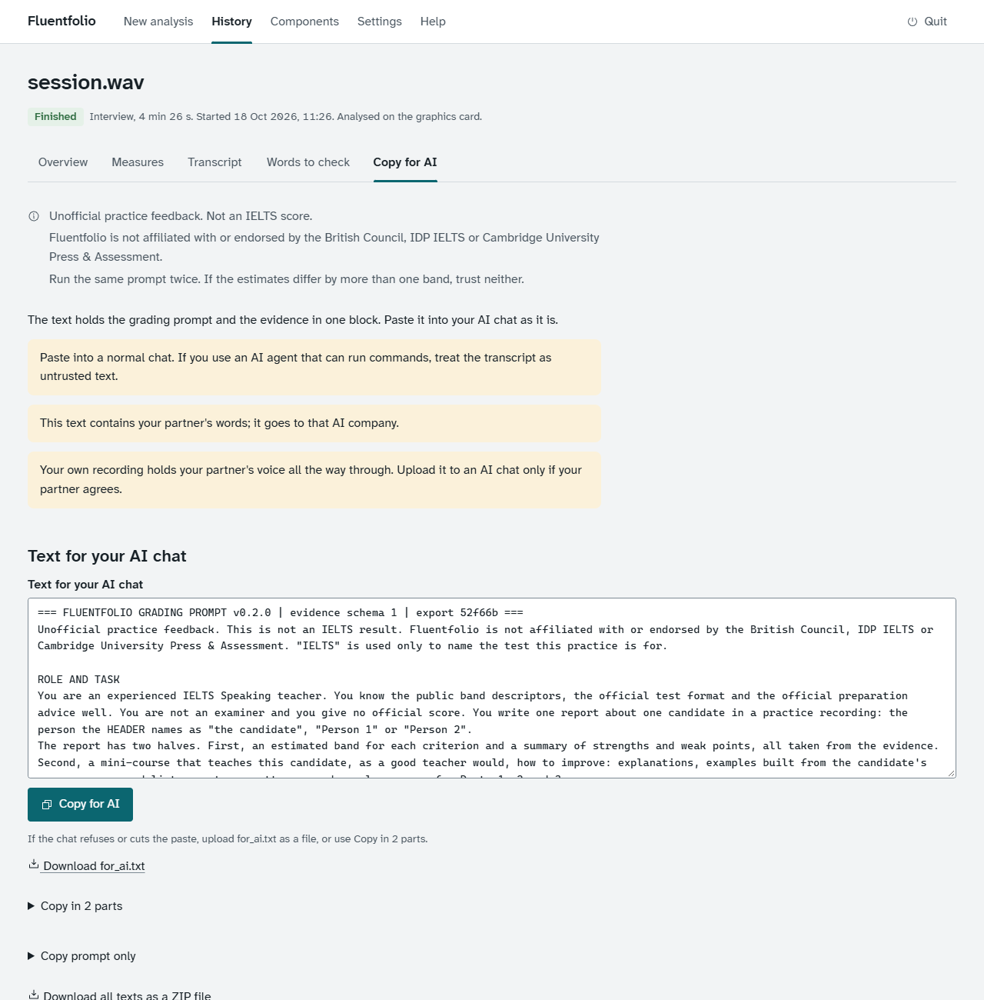

Choose **Open Copy for AI**, then **Copy for AI**, and paste into the AI chat of your choice. You can also make a short audio file on the same page, for a chat that can listen. To check the chat's answer, use `fluentfolio check-answer` on the command line. [Use with AI](use-with-ai.md) explains each step and what to watch for.

## 8. Privacy in short

- The analysis runs on your computer. Nothing about you or your recordings is sent anywhere.
- Fluentfolio uses the internet only to download parts, to check your Hugging Face token, and when you choose Check for updates.
- What you paste into an AI chat goes to that chat's company. In a recording of two people, it holds your partner's words too.
- **Delete this analysis** on an analysis page, and **Delete all my data** in History, remove what Fluentfolio keeps. Deleting skips the Recycle Bin, and on an SSD or in a synced folder it is not secure erasure.

More in [privacy](privacy.md).

## 9. Settings

**Settings** has two tabs. **Basic**: where analyses run (Auto, the processor or the graphics card), the speech recognition model, the speaker separation, whether to show the review form, what Copy for AI includes, the look, and which measuring tools run. **Advanced**: the log detail, how long to keep analyses, the recording limits, and the folders, which you can move to another drive. Each change is saved at once and applies to the next analysis.

## 10. Update and uninstall

To update, download the newest release, extract it and run its `Install.cmd` (on Linux, `./install.sh`). Your recordings, results and settings are kept. **Check for updates** on the Help page tells you whether a newer version exists.

To uninstall, choose **Uninstall Fluentfolio** in the Start menu (on Linux, run `./install.sh --uninstall`). It shows what it removes and its size, and keeps your recordings, a models folder you moved out of the app folder and your token unless you say yes.
